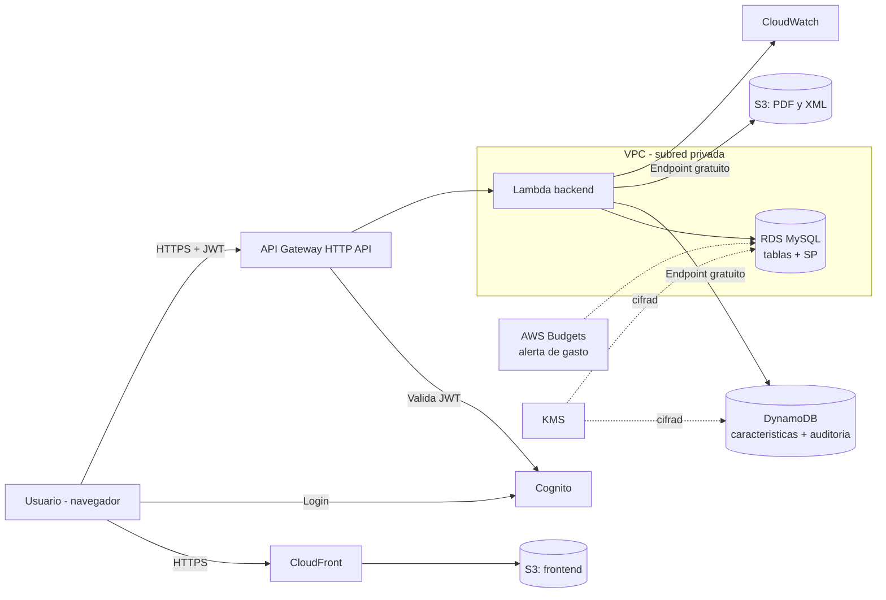
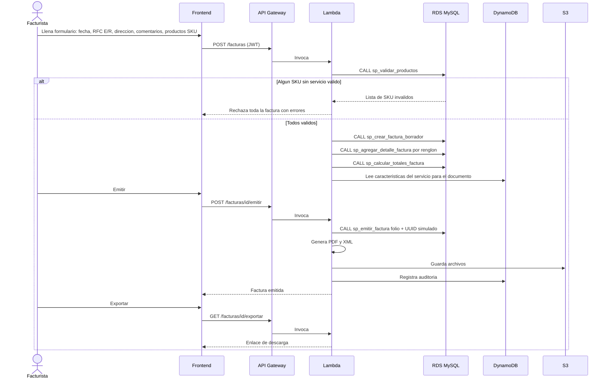
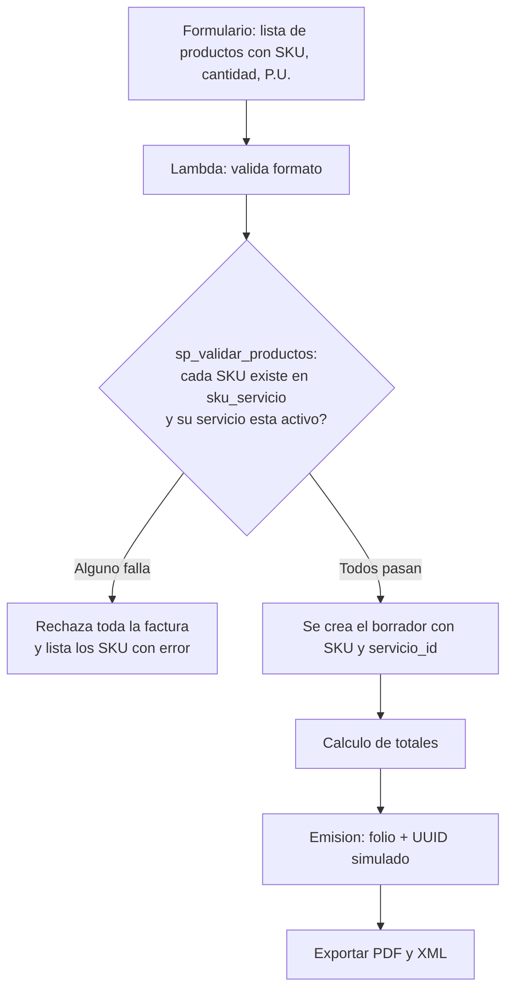

# Arquitectura AWS para un Sistema de Facturación (proyecto académico) — Versión 2

> **Convención.** **[Requisito]** = dado por el docente o el equipo. **[Decisión]** = acordada por el equipo en esta conversación. **[Propuesta]** = sugerencia mía, discutible. **[Supuesto]** = dato pendiente de confirmar.
>
> **Cambios respecto a la v1:** factura fiscal (CFDI con timbrado simulado), dos bases de datos (RDS MySQL + DynamoDB), SKU y formulario según el boceto del docente, validación de SKU contra el catálogo de servicios, presupuesto máximo de 50 USD (arquitectura de costo mínimo) y respaldo sin tercera tecnología.

---

## 1. Análisis del planteamiento

Se desarrollará un sistema de facturación en AWS con frontend y backend. El docente entregó un boceto que muestra un **formulario** con: fecha de factura, lista de productos (SKU, cantidad, precio unitario), RFC del emisor, RFC del receptor, dirección y comentarios, y una vista de la factura con opción de **exportar**.

El flujo definido por el equipo es: el usuario captura una lista de productos comprados; cada SKU se **asocia a un servicio** del catálogo; el sistema **valida que el servicio exista**. Los 100 servicios del catálogo son la base de esa validación.

**Restricciones del equipo:** presupuesto de **50 USD** en laboratorio de capa gratuita; no se desea sobreingeniería.

## 2. Requisitos identificados

| Tipo | Requisito | Origen |
|---|---|---|
| Explícito | Catálogo ≥ 100 servicios con ≥ 50 características cada uno | [Requisito] |
| Explícito | ≥ 10 Stored Procedures o equivalentes | [Requisito] |
| Explícito | ≥ 8 tablas o estructuras | [Requisito] |
| Explícito | Frontend + backend en AWS | [Requisito] |
| Explícito | Formulario de captura y exportación (según boceto) | [Requisito] |
| Explícito | Validar que cada SKU se asocie a un servicio existente | [Requisito] |
| Decisión | Factura fiscal (CFDI) | [Decisión] |
| Decisión | RDS MySQL + DynamoDB; sin tercera base de datos | [Decisión] |
| Decisión | Relación SKU→servicio: varios SKU por servicio | [Decisión] |
| Decisión | Carga inicial de la relación; si un SKU falla, se rechaza toda la factura | [Decisión] |
| Decisión | El equipo inventa y carga los 100 servicios y sus 50 características | [Decisión] |
| Decisión | Catálogo sin control de inventario | [Propuesta aceptada por omisión; confirmar] |
| Restricción | Presupuesto total 50 USD | [Requisito] |

**Supuestos pendientes:**

1. ¿El laboratorio es AWS Academy Learner Lab u otro? Afecta qué servicios están disponibles (Cognito en particular).
2. Formato de exportación: **PDF + XML simulado** [Propuesta]; confirmar con el docente.
3. Usuarios: solo personal interno [Supuesto].
4. Timbrado del CFDI: **simulado** (UUID de prueba) [Propuesta]; confirmar con el docente.
5. ¿Cuenta como SP un procedimiento de MySQL aunque el catálogo esté en DynamoDB? Debería; confirmar.

## 3. Problemas o inconsistencias detectadas

1. **DynamoDB no es MongoDB.** DynamoDB es un servicio propio de AWS; MongoDB es de un tercero (en AWS se usa vía Atlas) y DocumentDB solo es compatible con su API. **El equipo decidió no usar MongoDB**; esa decisión es correcta y no requiere más análisis.
2. **DynamoDB no tiene Stored Procedures.** Los SP reales viven en **RDS MySQL** (`CREATE PROCEDURE`). La validación de SKU contra DynamoDB no podría hacerse en un SP, por eso se mantiene una tabla ligera de servicios en MySQL (sección 7).
3. **Dos bases sin claves foráneas entre sí.** No hay integridad referencial entre MySQL y DynamoDB. Se mitiga manteniendo el identificador del servicio en ambas y cargándolo con un único script.
4. **"Servicios" vs. "productos".** El requisito habla de servicios; el boceto de productos y SKU. Se resuelve con el modelo: **productos comprados (SKU) → asociados a servicios del catálogo**.
5. **Factura fiscal vs. alcance académico.** Un CFDI válido exige timbrado de un PAC. Se **simula** el timbrado.
6. **Presupuesto de 50 USD.** Descarta NAT Gateway, RDS Proxy, Multi-AZ, Secrets Manager, SES, WAF y AWS Backup (sección 6).

## 4. Componentes necesarios del sistema

| Componente | Función |
|---|---|
| Autenticación y roles | Acceso controlado (Cognito o alternativa, sección 11) |
| Emisor | Datos fiscales de la empresa que factura (normalmente un registro) |
| Clientes (receptores) | RFC, razón social, dirección |
| Catálogo de servicios | 100+ servicios, cada uno con 50 características |
| Equivalencias SKU→servicio | Relaciona el código del producto con un servicio |
| Formulario de factura | Captura según el boceto |
| Validación de productos | Rechaza la factura si algún SKU no tiene servicio válido |
| Facturación | Encabezado + detalle + cálculo de impuestos + folio |
| Timbrado simulado | UUID de prueba y punto de integración para un PAC futuro |
| Exportación | PDF y XML |
| Pagos | Estado de cobro (alcance mínimo) |
| Auditoría | Bitácora de acciones |
| Reportes | Ventas por periodo |

No se incluye: control de inventario, notificaciones por correo, integración real con un PAC.

## 5. Arquitectura AWS propuesta

**[Propuesta]** Arquitectura serverless de tres capas, con dos bases con funciones distintas:

| Base | Qué guarda | Por qué ahí |
|---|---|---|
| **RDS MySQL** | Emisor, clientes, facturas, detalle, pagos, impuestos, folios, tabla ligera de servicios y equivalencias SKU→servicio, y **todos los SP** | Necesita transacciones, integridad, SP reales y validación con claves foráneas |
| **DynamoDB** | Las 50 características de cada servicio y la bitácora de auditoría | Lectura por clave (un servicio con sus 50 características en una sola consulta); auditoría de solo escritura que crece sin límite |

**Respaldo (sin tercera tecnología) [Decisión]:** copias automáticas y *snapshots* manuales de RDS; respaldo bajo demanda de DynamoDB antes de cada entrega; exportación a S3 si se desea.

**Servicios:** S3 + CloudFront (frontend), Cognito (autenticación, si está disponible), API Gateway (HTTP API), Lambda, RDS MySQL, DynamoDB, S3 (PDF y XML), CloudWatch, IAM, KMS (claves administradas por AWS).

## 6. Tabla de servicios AWS y justificación

| Servicio | Función | Decisión de costo | ¿Necesario? |
|---|---|---|---|
| **S3** | Frontend y archivos exportados (PDF/XML) | Costo mínimo | Sí |
| **CloudFront** | HTTPS y CDN del frontend | Dentro de capa gratuita según cuenta (verificar) | Recomendado |
| **Cognito** | Login, JWT, grupos/roles | Gratuito a bajo volumen; **verificar disponibilidad en el laboratorio** | Sí (con alternativa) |
| **API Gateway (HTTP API)** | API REST, valida JWT | Más barato que REST API | Sí |
| **Lambda** | Lógica de negocio, validación, PDF/XML | Cerca de cero a este volumen | Sí |
| **RDS MySQL** | Datos transaccionales y SP | **Gasto principal.** Instancia más pequeña, una sola zona, almacenamiento mínimo | Sí |
| **DynamoDB** | Características y auditoría | Modo bajo demanda | Sí |
| **VPC Gateway Endpoints (S3 y DynamoDB)** | Lambda en VPC alcanza S3 y DynamoDB | **Gratuitos** | Sí |
| **CloudWatch** | Logs y alarmas | Logs con retención corta | Sí |
| **AWS Budgets** | Alerta de gasto (50% y 80%) | Gratuito en uso básico | **Sí, desde el día 1** |
| **IAM / KMS** | Permisos mínimos y cifrado | Claves administradas por AWS | Sí |

**Descartados por costo o sobreingeniería:** NAT Gateway, RDS Proxy, RDS Multi-AZ, Secrets Manager, SES, WAF, AWS Backup, CloudTrail con almacenamiento adicional (el *Event history* básico ya registra la actividad reciente de la cuenta).

**Sobre las credenciales de MySQL sin Secrets Manager:** se guardan en variables de entorno de Lambda, cifradas con KMS. Es menos robusto que Secrets Manager; documentarlo como limitación aceptada por presupuesto.

**Nota de red:** una Lambda en la VPC (necesaria para alcanzar RDS privado) **no tiene salida a Internet** sin NAT. Por eso solo se usan servicios alcanzables por endpoints gratuitos (S3, DynamoDB). El *authorizer* JWT lo valida API Gateway, fuera de la VPC.

**Pendiente de verificar:** la capa gratuita y los precios cambian y dependen del tipo de cuenta. Revisar la página de precios de AWS y su calculadora con la configuración exacta. No se citan cifras aquí.

## 7. Modelo de datos

### 7.1 RDS MySQL (10 tablas)

| # | Tabla | Propósito | Atributos principales | Relaciones |
|---|---|---|---|---|
| 1 | `emisor` | Empresa que factura | `id`, `rfc`, `razon_social`, `regimen_fiscal`, `domicilio_fiscal` | 1–N `factura` |
| 2 | `cliente` | Receptor | `id`, `rfc`, `razon_social`, `direccion`, `uso_cfdi`, `activo` | 1–N `factura` |
| 3 | `categoria_servicio` | Agrupa servicios | `id`, `nombre` | 1–N `servicio` |
| 4 | `servicio` | **Versión ligera** del catálogo (el detalle está en DynamoDB) | `id`, `nombre`, `tipo` (servicio/producto), `categoria_id`, `impuesto_id`, `precio_base`, `activo` | N–1 categoría e impuesto |
| 5 | `sku_servicio` | Equivalencia SKU → servicio | `sku` (PK, alfanumérico único), `servicio_id` | N–1 `servicio` (varios SKU por servicio) |
| 6 | `impuesto` | Tasas | `id`, `nombre`, `tasa`, `activo` | 1–N `servicio` |
| 7 | `serie_folio` | Folios consecutivos | `serie`, `ultimo_folio` | Usada al emitir |
| 8 | `factura` | Encabezado | `id`, `serie`, `folio`, `uuid`, `fecha`, `emisor_id`, `cliente_id`, `forma_pago`, `metodo_pago`, `moneda`, `comentarios`, `estado`, `subtotal`, `impuestos`, `total`, `pdf_s3_key`, `xml_s3_key` | N–1 emisor y cliente |
| 9 | `factura_detalle` | Renglones (List Prod) | `id`, `factura_id`, **`sku`**, `servicio_id`, `descripcion`, `cantidad`, `precio_unitario`, `tasa_impuesto`, `importe` | N–1 factura y servicio |
| 10 | `pago` | Pagos | `id`, `factura_id`, `fecha`, `monto`, `metodo`, `referencia` | N–1 factura |

Reglas: `UNIQUE(serie, folio)`; `UNIQUE(uuid)`; `CHECK` de montos ≥ 0; el detalle **copia** descripción, precio y tasa al emitir; los campos fiscales (nombres, claves de catálogos del SAT) deben **verificarse contra el anexo técnico vigente**. Si se usa autenticación propia (ver sección 11) se añade `perfil_usuario`.

### 7.2 DynamoDB (2 tablas)

**Tabla `Catalogo`** — PK `SERVICIO#<servicio_id>`, SK según el ítem:

| Ítem | SK | Contenido |
|---|---|---|
| Datos del servicio | `META` | nombre, descripción, tipo |
| Característica (×50) | `CAR#<codigo>` | `grupo`, `nombre`, `tipo_dato`, `valor` |

Un `Query` con PK devuelve el servicio y sus 50 características en una sola consulta (51 ítems, muy por debajo de los límites). El catálogo de definiciones de características (nombre, tipo de dato, grupo) vive en la propia aplicación o en ítems `PK = DEF`, `SK = <codigo>`.

**Tabla `Auditoria`** — PK `ENTIDAD#<tipo>#<id>`, SK `<fecha-hora>#<id-evento>`; GSI por `usuario` + fecha. Se escribe desde Lambda (**no** desde un SP, porque un SP de MySQL no escribe en DynamoDB).

### 7.3 Integridad entre ambas bases

No hay clave foránea entre MySQL y DynamoDB. Se mantiene el mismo `servicio_id` en ambas y **un solo script de carga** las llena; las altas posteriores deben escribir en las dos desde el backend.

## 8. Diseño del catálogo de servicios

**100 servicios × 50 características = 5,000 valores** [Decisión: los inventa y carga el equipo]. **Catálogo mixto** (campo `tipo`), **sin control de inventario**.

Las 50 características son datos del servicio que respaldan la compra y la factura **[Supuesto a confirmar]**, en 5 grupos:

| Grupo | Características |
|---|---|
| **Identificación (10)** | código interno, nombre, descripción corta, descripción larga, categoría, subcategoría, tipo (único/recurrente), estado, fecha de alta, versión |
| **Comercial (10)** | precio base, moneda, precio por unidad, descuento máximo, periodicidad de cobro, modalidad de pago, contratación mínima, contratación máxima, vigencia del precio, promoción aplicable |
| **Fiscal y legal (12)** | clave de producto/servicio SAT, clave de unidad SAT, unidad de medida, objeto de impuesto, tasa de IVA, aplica IEPS, retención de IVA, retención de ISR, exento de IVA, fundamento legal o nota fiscal, requiere factura, cuenta contable |
| **Contractual (9)** | plazo del contrato, renovación automática, penalización por cancelación, política de reembolso, garantía, SLA, versión de términos y condiciones, requiere firma, requiere aviso de privacidad |
| **Operativa (9)** | responsable, área, tiempo de entrega, horario de atención, modalidad, canal de contratación, requisitos del cliente, documentos requeridos, observaciones |

**Carga:** un script (Python o Node) lee un CSV de servicios y otro de SKU, y escribe en MySQL (mediante SP) y en DynamoDB. Los valores pueden generarse con plantillas para no capturar 5,000 datos a mano. El **SKU** (alfanumérico único) no es la clave del SAT: son identificadores distintos; se guardan ambos.

## 9. Manejo del requisito de Stored Procedures

Los SP **reales** viven en **MySQL** (`CREATE PROCEDURE`; los procedimientos de MySQL pueden devolver conjuntos de resultados directamente). DynamoDB no tiene SP; lo que se hace desde Lambda **no se presenta como SP**.

| # | Procedimiento | Función |
|---|---|---|
| 1 | `sp_registrar_emisor` | Alta o actualización del emisor |
| 2 | `sp_crear_cliente` | Valida RFC y registra receptor |
| 3 | `sp_actualizar_cliente` | Modifica datos |
| 4 | `sp_registrar_servicio` | Alta de la versión ligera en MySQL |
| 5 | `sp_asociar_sku_servicio` | Registra equivalencia SKU → servicio |
| 6 | **`sp_validar_productos`** | Comprueba que **todos** los SKU existan y su servicio esté activo; si alguno falla, devuelve la lista de errores |
| 7 | `sp_crear_factura_borrador` | Crea encabezado |
| 8 | `sp_agregar_detalle_factura` | Agrega renglón (SKU, cantidad, P.U.) copiando datos del servicio |
| 9 | `sp_calcular_totales_factura` | Subtotal, impuestos, total |
| 10 | `sp_emitir_factura` | Bloquea la serie (`SELECT … FOR UPDATE`), asigna folio y UUID simulado, cambia estado; dentro de una transacción |
| 11 | `sp_cancelar_factura` | Cancela y registra motivo |
| 12 | `sp_registrar_pago` | Registra pago y actualiza estado |
| 13 | `sp_reporte_ventas_periodo` | Ventas agrupadas |

Son 13 (≥ 10). **Lógica en Lambda, no SP:** lectura de características en DynamoDB, escritura de auditoría, generación de PDF/XML. Documentar esta separación ante el docente.

## 10. Backend y frontend

**Frontend [Propuesta]:** SPA (React o Angular; usar lo que domine el equipo) con pantallas: login, formulario de factura según el boceto, catálogo de servicios con sus 50 características, clientes, SKU y equivalencias (opcional), reportes. El formulario muestra los errores de SKU devueltos por la validación y el botón **Exportar**.

**Backend [Propuesta]:** API REST en una sola base de código (monolito modular) desplegada en pocas funciones Lambda.

| Endpoint | Rol |
|---|---|
| `GET /servicios`, `GET /servicios/{id}` (consulta DynamoDB) | consulta |
| `POST /facturas/validar` (`sp_validar_productos`) | facturista |
| `POST /facturas` (crea, valida, agrega renglones, calcula) | facturista |
| `POST /facturas/{id}/emitir` (SP + timbrado simulado) | facturista |
| `GET /facturas/{id}/exportar?formato=pdf\|xml` | facturista |
| `POST /facturas/{id}/cancelar` | administrador |
| `POST /facturas/{id}/pagos` | facturista |
| `GET /reportes/ventas` | administrador |

**Regla de validación [Decisión]:** si **un solo** SKU no tiene servicio válido, se **rechaza toda la factura** y se devuelve la lista completa de SKU con error.

## 11. Seguridad

| Aspecto | Mecanismo |
|---|---|
| Autenticación | **Cognito**, si el laboratorio lo permite. **Alternativa** si no está disponible: usuarios en MySQL con contraseñas con *hash* (bcrypt) y JWT firmado por el backend; es menos robusta, pero viable para un proyecto académico |
| Autorización | Rol en el token (grupo de Cognito o campo del JWT) verificado en cada endpoint |
| Protección de API | HTTPS, authorizer JWT, *throttling*, CORS restringido |
| Credenciales de BD | Variables de entorno de Lambda cifradas con KMS (limitación aceptada por presupuesto) |
| Cifrado | En reposo: RDS, DynamoDB, S3. En tránsito: TLS |
| Control de acceso | IAM de mínimo privilegio por función; RDS en subred privada sin acceso público; *security groups* restrictivos; S3 sin acceso público |
| Protección de datos | Consultas parametrizadas, validación de entradas, no registrar RFC ni datos sensibles en logs |
| Auditoría | Tabla `Auditoria` en DynamoDB + CloudWatch Logs + historial de eventos de la cuenta |

Las facturas emitidas son inmutables: solo se cancelan.

## 12. Escalabilidad y disponibilidad

| Dimensión | Comportamiento |
|---|---|
| Usuarios, consultas | API Gateway y Lambda escalan automáticamente |
| Catálogo | DynamoDB escala sin cambios; 100 o 10,000 servicios no alteran el diseño |
| Facturas | Folios serializados por serie; suficiente para el alcance; más series si hiciera falta |
| Disponibilidad | Servicios administrados regionales. **RDS en una sola zona** por presupuesto: si falla la zona hay interrupción; se acepta |
| Respaldo y recuperación | Copias automáticas y *snapshots* de RDS; respaldo de DynamoDB bajo demanda |

Una sola región. Sin Kubernetes, microservicios ni multi-región.

## 13. Diagramas de arquitectura

### 13.1 Diagrama general

### 13.2 Flujo principal: capturar, validar y emitir una factura

### 13.3 Validación SKU → servicio

## 14. Evaluación de la solución

| Aspecto | Evaluación |
|---|---|
| **Ventajas** | SP reales en MySQL; validación con integridad referencial; DynamoDB con un papel técnico propio; sin tercera base; sin NAT ni servicios costosos |
| **Limitaciones** | Dos bases sin integridad entre sí; credenciales en variables de entorno; RDS en una sola zona; el timbrado es simulado |
| **Riesgos técnicos** | Superar los 50 USD si RDS queda encendido o se activa algún servicio con costo fijo; Cognito podría no estar disponible en el laboratorio; datos desincronizados entre MySQL y DynamoDB si se cargan por separado; campos y catálogos del SAT desactualizados |
| **Complejidad** | Moderada: ~10 servicios, dos bases, un solo código base |
| **Escalabilidad / Seguridad** | Suficiente para el alcance; seguridad aceptable con las limitaciones señaladas |
| **Mantenibilidad** | Buena si los SP viven en scripts SQL versionados y la carga es un solo script |
| **Costos** | El componente principal es la instancia de RDS y el tiempo que esté encendida. El resto debería ser marginal, pero **verifiquen con la calculadora oficial y la capa gratuita vigente de su cuenta**; no se citan cifras. Configuren AWS Budgets el primer día y eliminen lo que no usen |

**Hábitos para no exceder el presupuesto:** alerta en AWS Budgets al 50% y 80%; detener o eliminar RDS cuando no se use (una instancia detenida se reinicia sola a los 7 días); borrar *snapshots* y recursos de prueba; trabajar en una sola región.

## 15. Limitaciones y mejoras futuras

- Integrar un PAC real (muchos tienen ambiente de pruebas).
- Secrets Manager, Multi-AZ y RDS Proxy si hubiera presupuesto.
- Pantalla de administración de la relación SKU→servicio.
- Control de inventario, si el negocio lo requiriera.
- AWS Backup centralizado; WAF; CI/CD.

## 16. Conclusión

La arquitectura propuesta usa **RDS MySQL** para lo transaccional y los 13 SP reales, y **DynamoDB** para las 50 características y la auditoría, sin tercera base de datos ni MongoDB. El flujo del boceto del docente se implementa con un formulario que se valida contra el catálogo mediante `sp_validar_productos`, rechazando la factura completa si algún SKU no tiene servicio válido. La emisión genera un CFDI con timbrado simulado y exporta PDF y XML. Todo corre en una arquitectura serverless de costo mínimo, diseñada para mantenerse dentro de 50 USD siempre que se controle el tiempo de encendido de RDS.

**Antes de implementar, confirmar:** (1) si el laboratorio es AWS Academy Learner Lab y si Cognito está disponible; (2) formato de exportación y alcance del timbrado simulado con el docente; (3) que las 50 características son datos del servicio; (4) que el SP de MySQL cuenta para el requisito aunque el catálogo detallado esté en DynamoDB.
